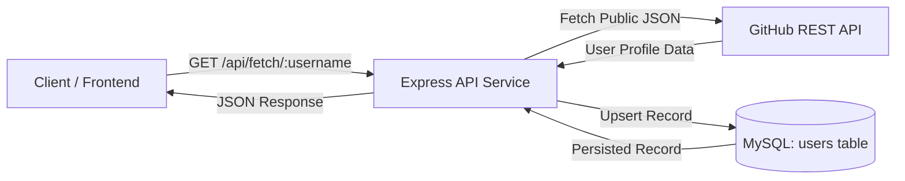

# GitHub Profile Analyzer API

> Node.js & Express RESTful service that aggregates GitHub developer profiles, computes public repo metrics, and handles idempotent persistence in MySQL.

[](https://nodejs.org/)
[](https://expressjs.com/)
[](https://www.mysql.com/)
[](https://restfulapi.net/)

---

## Overview

I built this service to explore backend data synchronization between third-party external APIs (GitHub REST API v3) and relational databases:
- **Idempotent Ingestion**: Handles automatic insertion of new developer profiles or updating existing records to keep cached metrics fresh.
- **Relational Schema**: Stores normalized developer handles, repo counts, follower counts, and account creation dates in MySQL.
- **REST Endpoints**: Endpoints for on-demand profile scraping, batch listing, and individual record retrieval.

---

## System Flow



---

## Endpoints

| Method | Endpoint | Description |
| :--- | :--- | :--- |
| `GET` | `/` | Health check (`"API is running..."`) |
| `GET` | `/api/fetch/:username` | Fetches live profile from GitHub, upserts into MySQL, and returns record |
| `GET` | `/api/fetch-all` | Lists all cached GitHub user profiles in the database |
| `GET` | `/api/fetch-user/:username` | Retrieves a single stored developer profile directly from MySQL |

### Example Payload (`GET /api/fetch/octocat`)
```json
{
  "username": "octocat",
  "name": "The Octocat",
  "followers": 15200,
  "following": 9,
  "publicRepos": 8,
  "avatar": "https://avatars.githubusercontent.com/u/583231?v=4",
  "bio": "GitHub mascot",
  "accountCreated": "2011-01-25"
}
```

---

## Tech Stack

- **Runtime**: Node.js (ES Modules)
- **Framework**: Express.js
- **Database Driver**: `mysql2/promise` (connection pooling & prepared statements)
- **Database**: MySQL 8.0+

---

## Setup & Local Run

### 1. Clone & Install
```bash
git clone https://github.com/V-Rytham/GitHub-Profile-Analyzer-API.git
cd GitHub-Profile-Analyzer-API
npm install
```

### 2. Configure MySQL Database
```sql
CREATE DATABASE github_analyzer;
USE github_analyzer;

CREATE TABLE users (
    id INT AUTO_INCREMENT PRIMARY KEY,
    username VARCHAR(255) UNIQUE,
    name VARCHAR(255),
    followers INT,
    following INT,
    publicRepos INT,
    avatar TEXT,
    bio TEXT,
    accountCreated DATE
);
```

### 3. Environment Variables
Create `.env` in the root directory:
```ini
PORT=8000
DB_HOST=localhost
DB_USER=root
DB_PASSWORD=your_mysql_password
DB_NAME=github_analyzer
```

### 4. Start Server
```bash
npm run dev
```

Server listens at `http://localhost:8000`.
